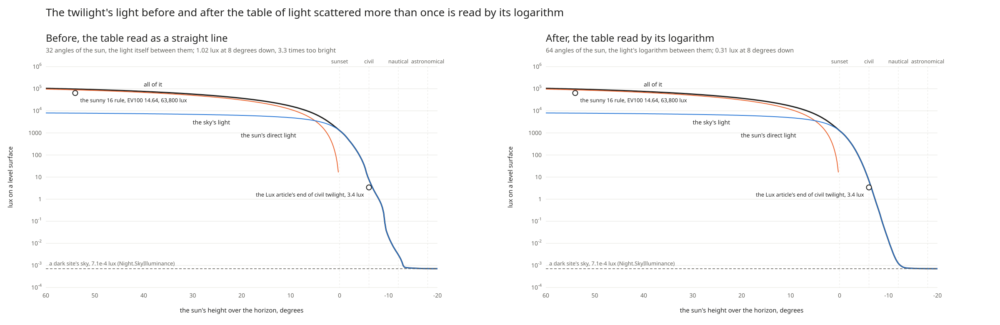
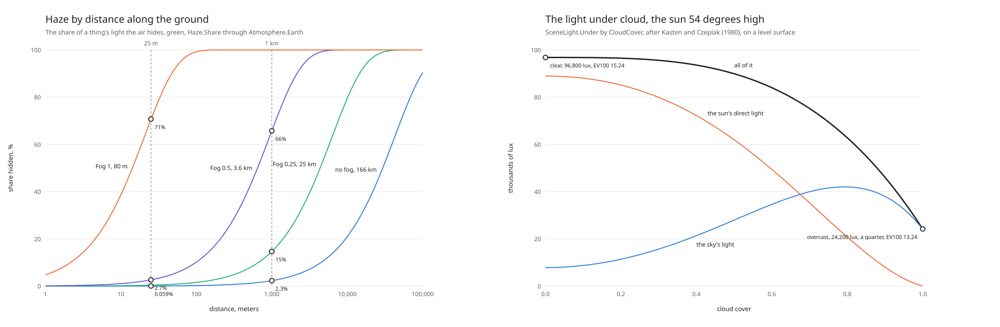
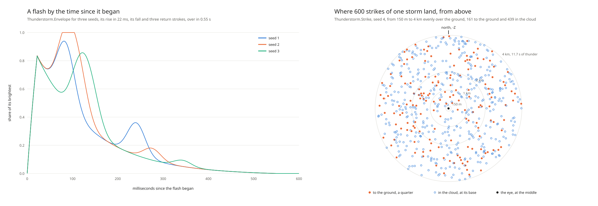
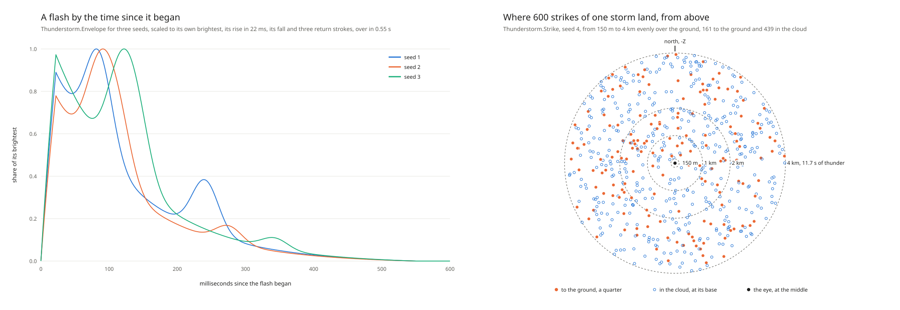
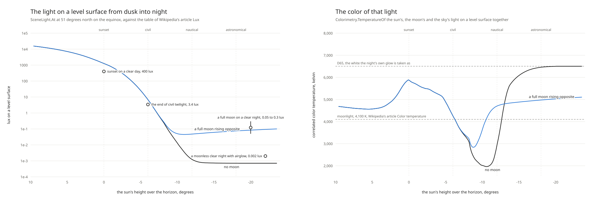
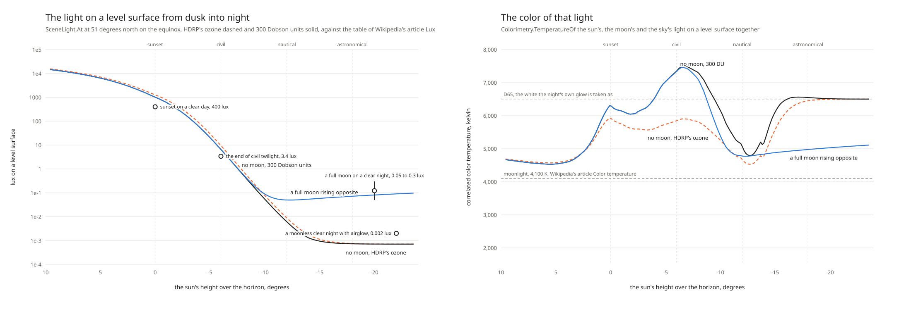
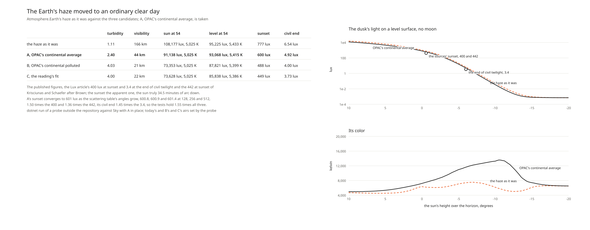
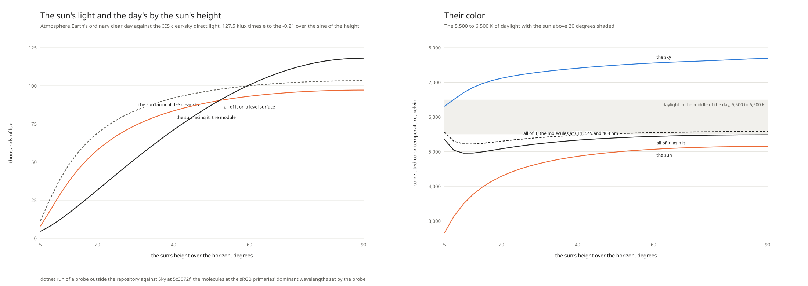
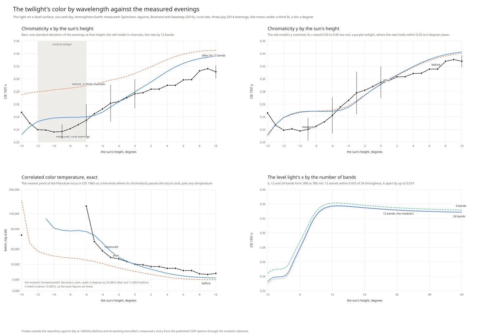

# Sky devlog

What landed in Sky, by day and newest first, with the pictures taken on the way, the captures the
repository keeps under `.github/assets` and the pictures made while an item was built, kept under
`.github/assets/readings` as WebP files named by their day, each on the day its name says, and the
notes written beside them as Markdown files named the same way. A line under Done names the item of
.github/REVIEW.md or .github/REVIEW-ARCHIVE.md and the commit that closed it.

## 2026-11-18

The light a scene takes on a level surface by the sun's height with no moon, the sun's direct light,
the sky's and their sum, 96,800 lux and an EV100 of 15.2 with the sun 54 degrees high against the
sunny 16 rule's 14.64, 7.7 lux at the end of civil twilight against the 3.4 of Wikipedia's article
Lux, and near the dark site's 7.1e-4 lux from 14 degrees down, the bends near 4 and 9 degrees down
standing on the coarse steps of the sky's table of light scattered more than once, which a table
four times finer smooths.

The scene's light through the twilight before, on the left, and after, on the right, the sky's table
of light scattered more than once holds 64 angles of the sun and is read between them by the light's
logarithm, the bend at 9 degrees down gone and the light 8 degrees down 0.31 lux where it was 1.02,
within 1% of a table of 512 angles, 6.8 lux at the end of civil twilight where it was 7.7, the day's
figures unchanged.

On the left the share of a thing's light the air hides along the ground by distance, green, 0.059%
at 25 m and 2.3% at a kilometer in clear air with a visibility of 166 km, 0.4% and 15% in a fog of
0.25, 2.7% and 66% in one of 0.5 and 71% at 25 m in the thickest fog of 80 m; on the right the light
on a level surface with the sun 54 degrees high by the cloud cover after Kasten and Czeplak, the
sun's direct light going to none and the sky's climbing to 42,000 lux at a cover of 0.8 before all
of it falls to a quarter of the clear day's, 24,200 lux, two stops down.

On the left a flash's brightness by the time since it began for three seeds, a rise in 22 ms, a fall
and three return strokes that brighten it again, dying away to none at 0.55 s; on the right where
600 strikes of one storm land seen from above, evenly over the ground from 150 m to 4 km, 161 of
them to the ground and the rest flashing in the cloud, the thunder of the farthest heard 11.7 s
after its flash.

The flashes of seeds 1 to 3 each scaled to its own brightest, so each reaches 1 once and comes to a
point there where seed 2's stood flat at 1 for some 30 ms and seed 1's never reached it, beside
where 600 strikes of one storm land seen from above with each ring's distance on it.

The scene's light on a level surface and its color from the sun 10 degrees up to 24 down at 51
degrees north on the equinox, with no moon and with a full moon rising opposite the sunset, against
the Lux article's 400 lux at sunset, 3.4 at the end of civil twilight, 0.05 to 0.3 under a full moon
and 0.002 on a moonless night and against moonlight's 4,100 K, the light's color falling to 1,962 K
at 10.5 degrees down where the twilight sky is blue.

The scene's light on a level surface and its color from dusk into night at 51 degrees north, with
the air ended at 55 km, dashed, and carried to 111 km, solid, the light at 6 degrees down 9.1 lux
where it was 6.5 and its color above 4,530 K through the twilight where it fell to 1,962 K at 10.5
degrees down, the day's light the same.

A reading of Atmosphere.Earth's ozone as set, a vertical optical depth of 0.011 in green, against a
column of 300 Dobson units after Bruneton, 0.028, with nothing committed, the day's light at 54
degrees 1.6% less and its color the same, at 10 degrees 6.6% less and 80 K warmer, the apparent
sunset 776 lux where it is 991 and the end of civil twilight 6.53 where it is 9.45, and the twilight
zenith's blue over red 3.6 at 10 degrees down where it is 2.9.

The scene's light and its color from dusk into night at 51 degrees north under the ozone as it was,
a third of a real column, dashed, and under the Earth's column of 300 Dobson units that
Atmosphere.Earth holds, solid, the light at the horizon 1,127 lux where it was 1,399 and at 6
degrees down 6.3 lux where it was 9.1, its color 7,400 K there where it was 5,850, with the
published figures beside them.

The apparent sunset's light on a level surface from a clear day's air of turbidity 3, 586 lux, with
each candidate switched alone, the haze's height moving it from 1.09 at 0.6 km to 0.85 at 3 km, a
haze that absorbs a fifth taking 4%, its phase and the ground's albedo nothing and a horizon hidden
to 6 degrees 1%, and the haze 2 km high and absorbing at a turbidity of 4 giving 447 lux against the
442 of Krisciunas and Schaefer.

What a binding pays to follow a moving sun, 6 to 10 microseconds a call of SceneLight.At at every
resolution, and what it pays when the air changes, SkyLight made in 10.9 ms at a quarter of its
tables' rows to 456 at four times and its ground table in 95 to 220 ms by the error its spans are
halved to, the noon's light the same at every one and the sunset's within 1% from half the tables'
rows and a ground error of 0.01.

Atmosphere.Earth's haze moved from the haze as it was to OPAC's continental average, a turbidity of
2.40 and a visibility of 44 km, the sun 54 degrees high 91,138 lux at 5,025 K where it was 108,177,
the level light 93,068 lux at 5,415 K where it was 95,225 at 5,433, the apparent sunset 600 lux
where it was 777 and the end of civil twilight 4.92 where it was 6.54, with OPAC's polluted type and
the reading's fit beside them, and the dusk's light and its color under the old haze and the new,
the twilight's light 13,600 K at 10.5 degrees down.

The color of the light on a level surface through the twilight, the sun's and the sky's together,
bluest in the nautical twilight under both hazes, 13,589 K at 10.5 degrees down under an ordinary
clear day's and 7,532 K at 7 down under the haze as it was, and with no ozone 6,894 K at most, so
the ozone's absorption makes the blue and the deeper haze multiplies it.

The sun's light facing it through Atmosphere.Earth by its height, 0.69 of the IES clear sky's at 5
degrees to 0.94 at the zenith as an ordinary day's beside a clear one, and the color of the day's
light on a level surface, 4,960 to 5,490 K from 10 degrees up, under the 5,500 to 6,500 K of
daylight in the middle of the day, the molecules read at the sRGB primaries' wavelengths raising it
by 100 to 220 K.

The light on a level surface through the twilight before the air was read by wavelength and after,
against the rural evenings Spitschan, Aguirre, Brainard and Sweeney measured, x at 6 degrees down
0.240 after and 0.289 before against their 0.235, the exact color temperature 44,300 K after and
12,200 before where theirs is 140,500, and the level light's x at 6, 12 and 24 bands, 12 within
0.003 of 24.

Commits that day

- `e6d564e` The moon reflects the sun band by band by the lunar disc's measured reflectance, so
  moonlight and the moonlit sky are redder than the sun's, and the Tools pin moves forward.
- `8988890` A color temperature is read as the nearest point of the Planckian locus rather than by a
  cubic that failed past 12,500 K, a light bluer than any black body reading as infinite.
- `f86a1f7` The air and the sky are read in twelve bands of wavelength and turned into color at the
  end, the sun outside the air its measured spectrum, so the day is bluer and the twilight matches
  measured evenings where it was purple.
- `128925a` The library carries the sun's measured spectrum and ozone's cross-sections by wavelength
  and turns a light by band into color through the standard observer, no figure moved yet.
- `6468401` The module writes cheatsheet as one word with the Tools checks that hold it, and a
  reading finds the key light turns from the sun to the moon unseen.
- `50df0c6` A reading of the sun's light and the day's by the sun's height against a clear-sky table
  and daylight's color, which finds the day too warm by the three wavelengths the air is read at.
- `5c3572f` A way of no length, a latitude past a pole and a cloud cover not a number are refused by
  name, where they gave a NaN or a crash from inside the sky's table.
- `b372cea` A binding makes the sky table's rows for a span of altitudes while its world loads, so
  no frame stalls on a first reading, and the rows made are counted.
- `9f03d0f` The sky's table holds its light at altitudes to 10 km, so a camera that flies or stands
  on a mountain reads the scene's light in microseconds, and the Tools checks gain the engine and
  link row facts.
- `3ca9c29` A test walks the twilight under hazes from the clearest air to a city's, so a table read
  too coarsely for one shows as a bend in its slope.
- `102482c` The README opens with a row of links to the devlog and the cheat sheet above its title.
- `6b941f3` A reading of the twilight's color against measured sources, with a test holding the
  light bluest in the nautical twilight as it was measured.
- `ef7224b` The module names no outside product, its tests and remarks saying what they hold in the
  module's terms and its two sheets naming the old haze and ozone as they were.
- `3c42619` The module names no engine outside its package and assembly, its documents and comments
  saying what any engine does and its source test reading the refused names from the Tools checks.
- `a2005ac` The module keeps a cheat sheet of every public type and member written from the built
  library, a test holding it to the library, and each parameterless constructor gains its summary.
- `a72ff9e` The Earth's air holds an ordinary clear day's haze, OPAC's continental average, so its
  sunset and its civil twilight stand near the published figures and its noon sun is dimmed as such
  a day dims it.
- `d055280` The Tools submodule moves to the head whose four checks each report their fault in the
  failing test's message.
- `1fe31bc` A reading of what a binding pays to follow a moving sun, the tables' build by their
  resolution against the noon's and the sunset's light, with the smallest within a percent.
- `26c9f88` The README links the devlog from its top row, and the guide names the command that
  writes it from the Tools submodule.
- `673a350` A reading of the sunset's light with each candidate for its gap to the published figures
  switched alone, which finds the gap in the haze the air holds rather than in the arithmetic.
- `5b50aab` The tests take the checks every module keeps from the Tools submodule in place of their
  own copies, and a clone without the submodule stops with the command that fetches it.
- `2a96c0a` A table of tests reads the sunset and the end of civil twilight at four turbidities of
  the air against two published sources, within twice them and within half as much again for a clear
  day's haze.
- `4f7b66f` The sky clock gives the apparent height the air lifts a body to, 34 minutes of arc at
  the horizon, and lifts the sun, the moon and the stars to it where the caller asks.
- `e15e341` The Earth's air holds a real column of ozone, 300 Dobson units, so the twilight is as
  blue as the ozone makes it and the day's light at 54 degrees is 1.6% less.
- `b3a8748` A reading of the day and the twilight under a real column of ozone beside the one the
  air holds, with the sunset's light read against its sources by the refraction, the haze and the
  ozone.
- `c2d05a2` The air reaches 111 km, so the twilight is lit through the air high above the earth's
  shadow and its zenith is blue where it reddened, the day's light the same within half a percent.
- `b4d65fb` A reading of the scene's light and color from dusk into night with and without a full
  moon, against published figures, which shows the twilight reddening where its sky is blue.
- `b0ca4b6` The sky below the horizon shows the ground under the sky's light as well as the sun's,
  so its lower half shows the ground lit from sunset through the twilight.
- `d4b3b0a` Every public type is named in the README's binding section or a table, the lightning
  strike among them, with the compass, the thread pool and the storm's owner said, and a test fails
  where one is missing.
- `e0d0ea9` The sky's light on a level surface is summed over one side of the sun's vertical plane
  and counted twice, taking half the time and the same lux at every turn of the sun.
- `340bfc9` Every lightning flash is scaled to its own brightest, so it reaches its peak once and
  comes to a point there rather than standing cut flat, its shape made once a strike as a flash of
  its own.
- `cc77f52` A storm's lightning strikes at the weather's rate as a Poisson process, each strike
  placed over the ground, flickered and heard by the speed of sound in the air's temperature, the
  same for a seed on every system.
- `f456c31` The cloud deck is given by its optical depth in place of a share of one engine's
  density, each preset keeping the light it took, the fog runs from clear air, and the look is said
  to be the pass an engine runs in place of its tonemapper.
- `3f6abf5` The library's sources name neither engine nor the framework under one, the dither's
  summary among them, and a test holds it.
- `7497862` Tests fail where the library references an engine, a window or a graphics API, takes
  anything past .NET's own assemblies or calls into native code.
- `4d45423` A host in the tests runs the README's smallest binding word for word, so the suite fails
  where the guide and the library part.
- `5268d6e` The README says how any engine binds the module, the conventions it stands on and the
  smallest binding, and a haze test gives the clear air's value by its physics.
- `b40fdfd` The library builds the assembly and package 3DEngine.Sky and its tests
  3DEngine.Sky.Tests, the namespace staying Sky.
- `d5e51a5` The weather reaches the light, the air near the ground hazing a thing by its distance
  clear and in fog with its visibility by Koschmieder's law, and the cloud cover dimming the sun and
  the moon into the sky's light after Kasten and Czeplak.
- `9b8f67b` The sky's light at the ground is read from a table that halves its rows where the light
  bends, so the scene's light at an hour takes microseconds and holds within 1% of the sum over the
  dome.
- `05d0203` The sky's table of light scattered more than once holds 64 angles of the sun and is read
  by the light's logarithm, so the twilight darkens without a bend and 8 degrees down is lit 0.31
  lux where it was three times too bright.
- `653f1fc` The scene's light at an hour of the sky clock comes as one sum of the sun, the moon, the
  sky lit by each and the night's own, with the key light's way and an incident meter's EV100,
  pinned against the sunny 16 rule, the end of civil twilight and a full moon.
- `8493827` The share of the sun's and the moon's disc above the horizon is exactly 1 and 0 at its
  ends on every processor, since arm64 rounded a disc wholly up to 0.99999994.
- `9a096f0` The sky clock gives the moon's phase angle in degrees, which the moon's light takes, its
  lit share the clock's own at every age.
- `1fc8aca` The sun gains its disc, half a degree wide and 1.6e9 candelas a square meter under a
  high sun, the share of it and of the moon above the horizon, and its light through the air for any
  strength or color.
- `810d255` A test reads the sources and fails on a comment line past 100 columns, four comments
  broken mid-sentence are joined, and the guide links the devlog.
- `4995289` The comments of the library and its tests are wrapped to 100 columns, and the sky
  light's comment broken mid-sentence is joined, with no word or code changed.
- `fbdde48` The look settings describe their order and the vivid look without naming an engine, and
  the devlog is generated from the review.

## 2026-11-17

Commits that day

- `789f0e1` The ignore file's note on the pictures folder names no one, and the guides spell
  canceled.

## 2026-11-08

Done that day

- Item 5 at `ff8f9df`. The night's model.

Commits that day

- `a9573d6` The catalog of bright stars is spelled the American way where it is a common noun, the
  Bright Star Catalogue keeping its own name.
- `ff8f9df` The module holds the night, the Bright Star Catalogue placed by the sky clock with each
  star's light by its magnitude, the moon's disc with the earthshine on its dark part, and the Milky
  Way's band.

## 2026-11-02

Done that day

- Item 3 at `fbc385e`. The model, in two parts.

## 2026-11-01

Commits that day

- `a5e474b` The module holds the air as data, the sun's and the moon's light at the ground in lux
  and kelvin, and the sky's luminance and illuminance by single and multiple scattering.
- `bff9e47` The module gains its solution, an empty library whose public members need summaries, a
  test that it loads, the version at 0.1 and a build workflow on Linux, Windows and macOS.
- `c5ee6a9` The module gains its documents, AGENTS.md, the README, STYLE.md, COMMITS.md and the code
  of conduct as the other modules keep them, with git's ignore and attribute files.
