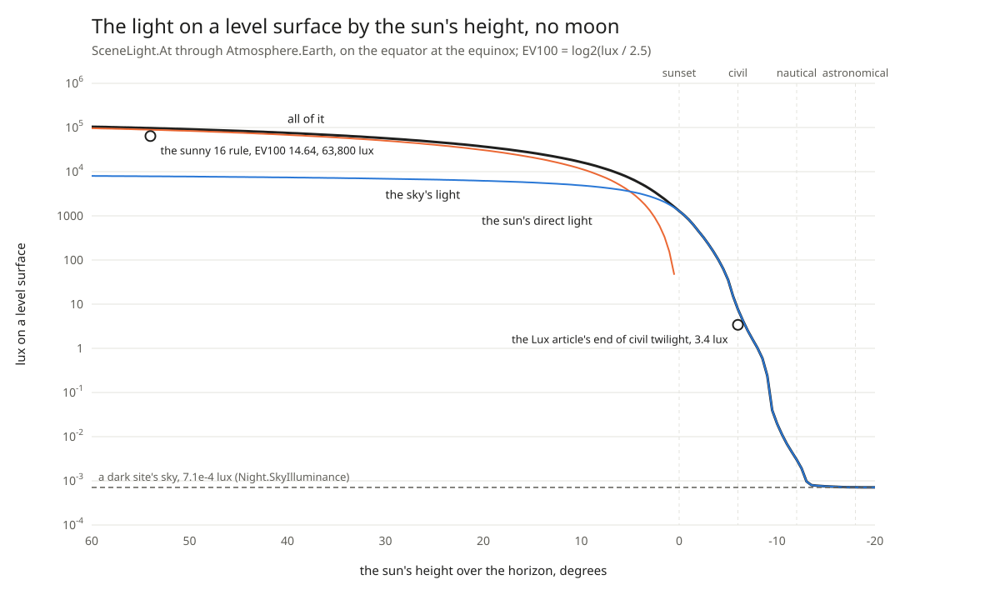
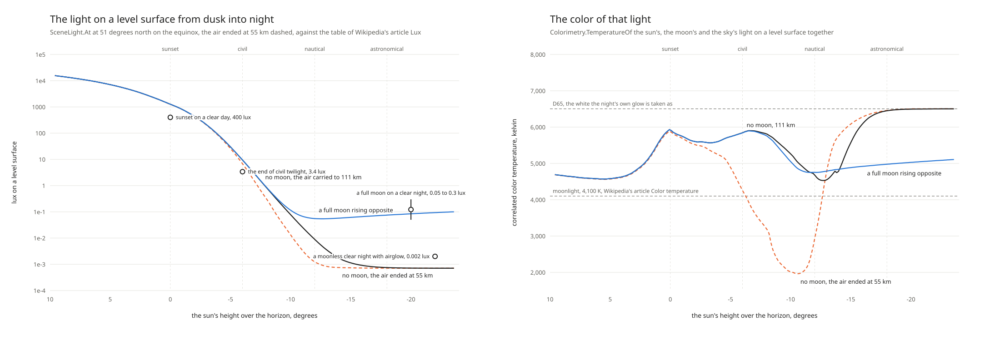
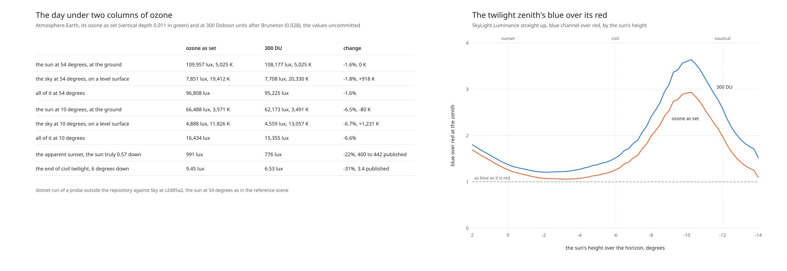
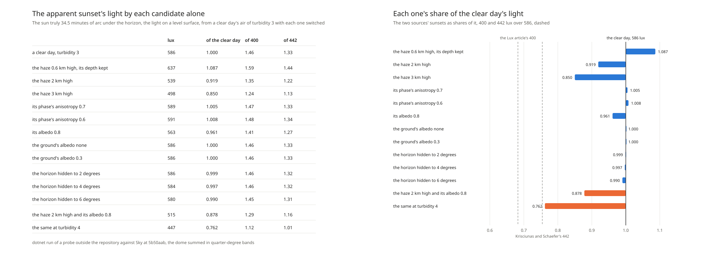
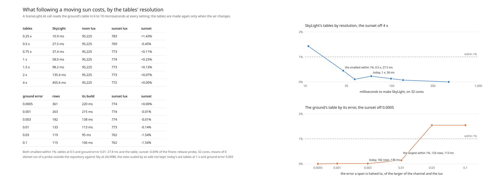
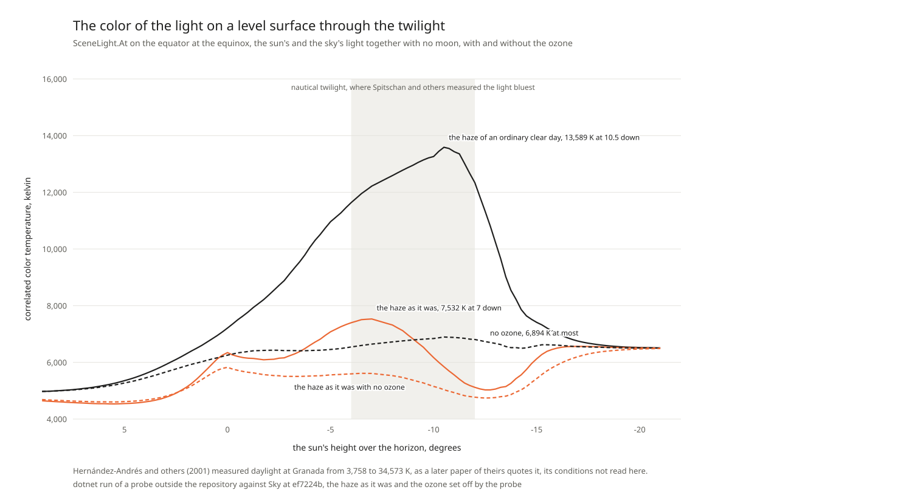

# Sky devlog

What landed in Sky, by day and newest first, with the pictures taken on the way, the captures the
repository keeps under `.github/assets` and the pictures made while an item was built, kept under
`.github/assets/readings` as WebP files named by their day, each on the day its name says, and the
notes written beside them as Markdown files named the same way. A line under Done names the item of
.github/REVIEW.md or .github/REVIEW-ARCHIVE.md and the commit that closed it.

## 2026-11-18

The light a scene takes on a level surface by the sun's height with no moon, the sun's direct light,
the sky's and their sum, 96,800 lux and an EV100 of 15.2 with the sun 54 degrees high against the
sunny 16 rule's 14.64, 7.7 lux at the end of civil twilight against the 3.4 of Wikipedia's article
Lux, and near the dark site's 7.1e-4 lux from 14 degrees down, the bends near 4 and 9 degrees down
standing on the coarse steps of the sky's table of light scattered more than once, which a table
four times finer smooths.

The scene's light through the twilight before, on the left, and after, on the right, the sky's table
of light scattered more than once holds 64 angles of the sun and is read between them by the light's
logarithm, the bend at 9 degrees down gone and the light 8 degrees down 0.31 lux where it was 1.02,
within 1% of a table of 512 angles, 6.8 lux at the end of civil twilight where it was 7.7, the day's
figures unchanged.

On the left the share of a thing's light the air hides along the ground by distance, green, 0.059%
at 25 m and 2.3% at a kilometer in clear air with a visibility of 166 km, 0.4% and 15% in a fog of
0.25, 2.7% and 66% in one of 0.5 and 71% at 25 m in the thickest fog of 80 m; on the right the light
on a level surface with the sun 54 degrees high by the cloud cover after Kasten and Czeplak, the
sun's direct light going to none and the sky's climbing to 42,000 lux at a cover of 0.8 before all
of it falls to a quarter of the clear day's, 24,200 lux, two stops down.

On the left a flash's brightness by the time since it began for three seeds, a rise in 22 ms, a fall
and three return strokes that brighten it again, dying away to none at 0.55 s; on the right where
600 strikes of one storm land seen from above, evenly over the ground from 150 m to 4 km, 161 of
them to the ground and the rest flashing in the cloud, the thunder of the farthest heard 11.7 s
after its flash.

The flashes of seeds 1 to 3 each scaled to its own brightest, so each reaches 1 once and comes to a
point there where seed 2's stood flat at 1 for some 30 ms and seed 1's never reached it, beside
where 600 strikes of one storm land seen from above with each ring's distance on it.

The scene's light on a level surface and its color from the sun 10 degrees up to 24 down at 51
degrees north on the equinox, with no moon and with a full moon rising opposite the sunset, against
the Lux article's 400 lux at sunset, 3.4 at the end of civil twilight, 0.05 to 0.3 under a full moon
and 0.002 on a moonless night and against moonlight's 4,100 K, the light's color falling to 1,962 K
at 10.5 degrees down where the twilight sky is blue.

The scene's light on a level surface and its color from dusk into night at 51 degrees north, with
the air ended at 55 km, dashed, and carried to 111 km, solid, the light at 6 degrees down 9.1 lux
where it was 6.5 and its color above 4,530 K through the twilight where it fell to 1,962 K at 10.5
degrees down, the day's light the same.

A reading of Atmosphere.Earth's ozone as set, a vertical optical depth of 0.011 in green, against a
column of 300 Dobson units after Bruneton, 0.028, with nothing committed, the day's light at 54
degrees 1.6% less and its color the same, at 10 degrees 6.6% less and 80 K warmer, the apparent
sunset 776 lux where it is 991 and the end of civil twilight 6.53 where it is 9.45, and the twilight
zenith's blue over red 3.6 at 10 degrees down where it is 2.9.

The scene's light and its color from dusk into night at 51 degrees north under the ozone as it was,
a third of a real column, dashed, and under the Earth's column of 300 Dobson units that
Atmosphere.Earth holds, solid, the light at the horizon 1,127 lux where it was 1,399 and at 6
degrees down 6.3 lux where it was 9.1, its color 7,400 K there where it was 5,850, with the
published figures beside them.

The apparent sunset's light on a level surface from a clear day's air of turbidity 3, 586 lux, with
each candidate switched alone, the haze's height moving it from 1.09 at 0.6 km to 0.85 at 3 km, a
haze that absorbs a fifth taking 4%, its phase and the ground's albedo nothing and a horizon hidden
to 6 degrees 1%, and the haze 2 km high and absorbing at a turbidity of 4 giving 447 lux against the
442 of Krisciunas and Schaefer.

What a binding pays to follow a moving sun, 6 to 10 microseconds a call of SceneLight.At at every
resolution, and what it pays when the air changes, SkyLight made in 10.9 ms at a quarter of its
tables' rows to 456 at four times and its ground table in 95 to 220 ms by the error its spans are
halved to, the noon's light the same at every one and the sunset's within 1% from half the tables'
rows and a ground error of 0.01.

Atmosphere.Earth's haze moved from the haze as it was to OPAC's continental average, a turbidity of
2.40 and a visibility of 44 km, the sun 54 degrees high 91,138 lux at 5,025 K where it was 108,177,
the level light 93,068 lux at 5,415 K where it was 95,225 at 5,433, the apparent sunset 600 lux
where it was 777 and the end of civil twilight 4.92 where it was 6.54, with OPAC's polluted type and
the reading's fit beside them, and the dusk's light and its color under the old haze and the new,
the twilight's light 13,600 K at 10.5 degrees down.

The color of the light on a level surface through the twilight, the sun's and the sky's together,
bluest in the nautical twilight under both hazes, 13,589 K at 10.5 degrees down under an ordinary
clear day's and 7,532 K at 7 down under the haze as it was, and with no ozone 6,894 K at most, so
the ozone's absorption makes the blue and the deeper haze multiplies it.

## 2026-11-08

Done that day

- Item 5 at `ff8f9df`. The night's model.

## 2026-11-02

Done that day

- Item 3 at `fbc385e`. The model, in two parts.
