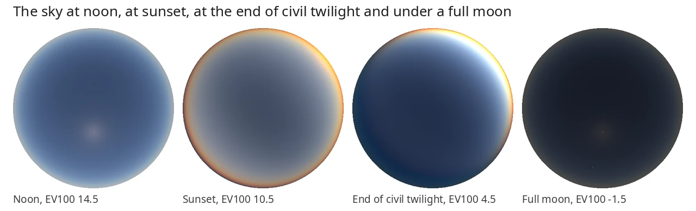
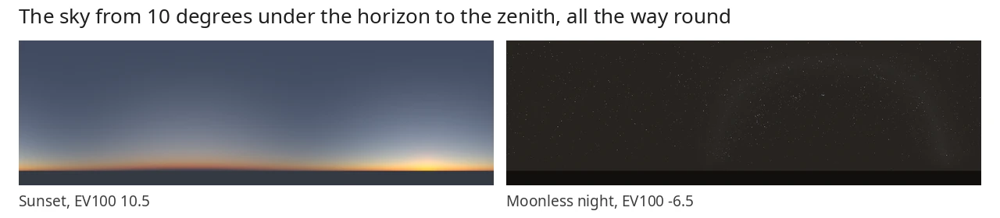

[Devlog](https://github.com/EggyStudio/3DEngine.Atmosphere/blob/main/DEVLOG.md) [Cheatsheet](https://github.com/EggyStudio/3DEngine.Atmosphere/blob/main/CHEATSHEET.md)

# Atmosphere



The module's own sky as a fisheye at noon, at sunset, at the end of civil twilight and under a full moon, each at the exposure its label gives.



The same sky as a panorama, at sunset and on a moonless night, each at the exposure its label gives.

Atmosphere is a physically based sky, an atmosphere worked out by wavelength in twelve bands from
380 to 780 nm, the sun's, the moon's and the night's light in lux and candelas a square meter, the
sky's clock, the weather and the looks by the sun's height. An engine takes it as a git submodule,
lights its scenes from its numbers and draws its sky on a GPU from the tables a made sky gives. It
references no engine, and each engine implements the interfaces it declares where it binds the
module.

## What it holds

| Type | Gives |
|---|---|
| `Air` | The air as data, the planet's radius, the molecules' scattering, the aerosols' extinction and the ozone's absorption with their heights, the ground's albedo, and the transmittance along a way through it. `Air.Earth` is the Earth's air on a clear day, a real column of ozone, 300 Dobson units, `Air.ContinentalAverage` an ordinary day's, and `WithTurbidity` sets its haze |
| `Sun` | The sun's light outside the air, 133,800 lux in its measured spectrum's color, and `Sun.At`, its lux, color and color temperature at the ground for its height over the horizon, with its disc's size, its luminance and the share of it above the horizon, and `Sun.Through` for a light of another strength or color |
| `SkyLight` | The sky's luminance along a way and its illuminance on a level surface, the sun's light scattered once and more than once, in candelas a square meter and lux, with the illuminance at the ground read from a table in microseconds |
| `SkyTables` and `SkyLaneTables` | A made `SkyLight`'s tables as a read-only view, each lane's transmittance, light scattered more than once and ground table with its sizes and axes, the air's coefficients in its bands and the matrix that turns its bands into linear sRGB, for a sky drawn on a GPU |
| `SceneLight` | The light a scene takes at an hour of a `SkyClock`, the sun's and the moon's at the ground by the share of their discs above the horizon, the sky's lit by each and the night's own on a level surface, the key light's way, and the EV100 an incident meter gives for all of it, and the same light under a `WeatherConditions`'s cloud |
| `Haze` | The air near the ground between the eye and what it sees, the share of a thing's light that comes through a distance and the share hidden, clear and in a `WeatherConditions`'s fog, and the visibility by Koschmieder's law |
| `Moon` and `Night` | The moon's light by its phase and height, redder than the sun's by the lunar disc's reflectance, its disc's size and luminance and the earthshine on its dark part, and a moonless sky's luminance, illuminance and color with the Milky Way's band over it |
| `Stars` and `Star` | The Bright Star Catalogue's 9,096 stars, their places, magnitudes and colors, and a star's illuminance and luminance by its magnitude |
| `Thunderstorm` | A storm's lightning about a place at a `WeatherConditions`'s rate of strikes, each placed, timed and flickered from the storm's seed, with the flash's light at a distance and the thunder's delay by the air's temperature, each strike a `LightningStrike`, and a `LightningFlash`, one strike's flicker made once from its seed |
| `Colorimetry` | Linear sRGB's luminance and a black body's color, to and from its temperature |
| `SkyClock` | Where the sun, the moon and the stars stand at an hour of a day of the year for a latitude, by spherical astronomy, with the moon's phase, how far the stars have turned about the pole, and the part of the day, a `DayPhase`, the sun's height makes it |
| `WeatherState` | The weather as it goes, its `WeatherConditions` easing toward a `WeatherPreset` or toward a forecast a `WeatherClimate` writes from the clock, the wind gusting and the ground wetting in rain and whitening under snow |
| `LookCycle` | A camera's look by the sun's height, the `LookSettings` kept at heights of the sun and worked out between the two about any other, its curve a `LookCurve` |

Through the Earth's air, its own ozone and a clear day's haze, the sun 54 degrees high reaches
the ground at 111,700 lux and 5,292 K and the sky lights a level surface with 9,200 lux beside the
sun's 90,400 (`dotnet test Atmosphere.Tests`). The air takes the light in 12 bands of wavelength
and turns it into color at the end.

## Taking it into an engine

An engine adds the repository as a git submodule under `modules/` and references its project, here
from a project one folder below the engine's root.

```bash
git submodule add https://github.com/EggyStudio/3DEngine.Atmosphere.git modules/Atmosphere
```

```xml
<ProjectReference Include="..\modules\Atmosphere\Atmosphere\Atmosphere.csproj" />
```

The project builds the assembly `3DEngine.Atmosphere`, whose types are in the namespace
`Atmosphere`.

A clone of the engine fetches the module with `git clone --recurse-submodules`, or with
`git submodule update --init` in a clone made without it, and a workflow checks it out with
`submodules: true` on `actions/checkout`. A change the engine uses is committed and pushed here
before the engine's commit that moves its pointer, so the engine's history never names a commit
this repository does not have.

## Binding it in your engine

The module declares no interface, since it asks nothing of an engine. It draws nothing, opens no
window, reads no file (the star catalog is carried in its assembly) and keeps no thread of its own,
making a `SkyLight`'s tables on .NET's thread pool, so a binding is the engine's code that calls
it and gives the numbers it returns to the engine's lights, sky, fog and camera. The library
references nothing past .NET's own assemblies, which a test of its own holds.

It stands on these conventions.

- Lengths are in meters, and an altitude is meters above the ground.
- +Y is up, -Z north and +X east, so the axes are right-handed with +Z south. A way toward a body
  points from the place to it, and a directional light from that body shines along its negative.
- A height over the horizon, a latitude, a disc's angular size and the moon's phase angle are in
  degrees, and so is a compass direction, as `WeatherConditions.WindFrom`, clockwise from north. A
  right ascension, a declination and `SkyClock.SkyTurn` are in radians.
- A height is the true one, unbent by the air, unless `SkyClock.Refracted` is set, which
  lifts the sun, the moon and the stars to the heights an eye sees them at, 34 minutes of arc at
  the horizon by `SkyClock.ApparentAltitude`. A published sunset is the apparent one, and a
  twilight's degrees are the sun's true height.
- `SkyClock.Hour` is the local solar time from 0 to 24, noon when the sun stands highest, and
  `DayOfYear` counts from 0 on the first of January in a year of 365 days. `WeatherState` advances
  by seconds.
- A color is linear sRGB, the BT.709 primaries with a D65 white and no transfer curve. Where a
  color carries a light, its luminance is the light's lux or candelas a square meter; a
  `CelestialLight`'s color has a luminance of 1 and its illuminance carries the strength.
- `Air.Earth` is a clear day's air as Hillaire's sky and atmosphere rendering technique of
  2020 sets it, a visibility of 178 km and a turbidity of 1.09, its day sky a deep blue with a
  tight halo about the sun and its apparent sunset and end of civil twilight within twice the
  published figures. `Air.ContinentalAverage` is an ordinary day's, OPAC's continental
  average haze, 44 km and 2.39, its sunset and civil twilight within 1.55 times them. A binding
  with another day's air sets it through `Air.WithTurbidity` and the haze's terms.
- Illuminance is in lux, luminance in candelas a square meter, a color temperature in kelvin and an
  exposure in EV100 by an incident meter's calibration of 250. The sun gives 133,800 lux outside the
  air, and an engine whose sun is another strength scales what the module returns by its sun's over
  `Sun.OutsideIlluminance`. A color temperature is the CIE's correlated one, the black body's
  nearest the color in CIE 1960's uv, read by `Colorimetry.TemperatureOf`. A light bluer than any
  black body, as the measured nautical twilight's is, reads as `float.PositiveInfinity`, so a
  binding that shows the twilight's color reads its chromaticity instead. A light redder than a
  black body at 1,000 K reads 1,000.
- A `SkyLight` makes its table of the sky's light at an altitude the first time that altitude is
  read, two thirds of a second to four fifths a row, so a binding calls
  `SkyLight.PrepareGround` over the altitudes its camera keeps while the world loads, and reads
  the light in microseconds after.
- A `SkyLight` does not change once made and is read from any thread, as a `LightningFlash` is.
  A `SkyClock`, a `WeatherState` and a `Thunderstorm` change as they advance and belong to one
  caller.

The smallest binding makes the sky once and reads the scene's light each step of the world's clock,
in a file that references the assembly `3DEngine.Atmosphere` and opens the namespaces `Atmosphere`
and `System.Numerics`. `host` stands for the engine's own calls, whatever it names them.

```csharp
// Once, as the world loads and off the frame, the air, its sky and the sky's ground table.
var sky = new SkyLight(Air.Earth);
sky.PrepareGround(0, 2_000);
host.UploadSkyTables(sky.Tables);
var clock = new SkyClock { Latitude = 51, DayOfYear = 172, Hour = 15 };
var weather = new WeatherState { Clock = clock, Forecast = true };

// Each step of the world's clock, seconds long.
clock.Advance(seconds / 3600);
weather.Advance(seconds);
var light = SceneLight.At(clock, sky).Under(weather.Current);
var key = light.MoonIsKey ? light.Moon : light.Sun;
host.SetDirectionalLight(-light.KeyToward, key.Color * key.Illuminance);
host.SetAmbientLuminance(light.SkyIlluminance / MathF.PI);
host.SetExposure(light.Exposure);
host.SetFogExtinction(Haze.Extinction(sky.Air, weather.Current));
```

The ambient luminance is the sky's illuminance over pi, the luminance of a sky alike over its
dome that lights a level surface as this one does. An engine that draws its own sky reads
`SkyLight.Luminance` along each way, the sun's disc from `Sun.DiscLuminance`, the moon's from
`Moon`, and the stars from `Stars.Catalog` placed by `SkyClock.TowardSky`. The tests draw the sky so
on the CPU with no engine, `Atmosphere.Tests/SkyPicture.cs`, a fisheye and a panorama of each scene
written where `ATMOSPHERE_PICTURES` names a folder, as a reference a binding's own sky is set
against. An engine that draws its sky in a pass of its own on the GPU reads `Air`'s terms into it,
and one whose renderer holds an atmosphere and clouds of its own feeds them from the clock and the
weather.

### Drawing the sky on a GPU

`SkyLight.Tables` holds a made sky's tables and the terms its arithmetic reads, read-only, which an
engine uploads once a sky is made, the binding's `host.UploadSkyTables`, and a pass of its own
repeats `SkyLight.Luminance` from them. The sky is held in lanes of three wavelength bands, each lane
its own tables, its air's coefficients in its bands and its sun's light outside the air, and every
table holds three floats a cell, one a band, row after row. For each lane, the light along a unit way
`v` from an altitude `h` in meters, the sun toward the unit way `s`, both with +Y up, is this.

- The way's length. With `R` the planet's radius, `r = R + max(h, 0)` and `m = v.y`, the way meets
  the ground at `-r m - sqrt(r^2 (m^2 - 1) + R^2)` where `m < 0` and the root's argument is not
  negative, and otherwise leaves the air at `max(0, -r m + sqrt(r^2 (m^2 - 1) + (R + Top)^2))`, or
  at 0 where that argument is not positive. The march runs to the ground where the way meets it.
- The steps. Of `ViewSteps`, 48, step `i` runs from `D (i / 48)^2` to `D ((i + 1) / 48)^2` of the
  way's length `D`, and is read at its middle distance `d`: the point `p = (0, R + h, 0) + v d`, its
  altitude `|p| - R` and its up `p / |p|`, and the sun's cosine there `up . s`.
- The air at an altitude `y`, `y` held at 0 at least in the exponentials. The molecules scatter
  `RayleighScattering e^(-y / RayleighScaleHeight)` and the aerosols take out `AerosolExtinction
  e^(-y / AerosolScaleHeight)`, scattering `AerosolAlbedo` of it; the ozone absorbs `OzoneAbsorption
  max(0, 1 - |2 (y - OzoneBottom) / OzoneWidth - 1|)`; the extinction is the three's sum.
- The phases, with `c = v . s` and `g` the `AerosolAnisotropy`: the molecules' `3 (1 + c^2) / (16
  pi)`, and the aerosols' Cornette and Shanks `3 (1 - g^2) (1 + c^2) / (8 pi (2 + g^2) b^1.5)` with
  `b = max(1 + g^2 - 2 g c, 1e-6)`.
- The tables, `Transmittance` and `Scattered`, each read at an altitude and a cosine in row `sqrt(
  clamp(y / Top, 0, 1)) (rows - 1)` and column `(clamp(cosine, -1, 1) + 1) / 2 (columns - 1)`,
  bilinearly, the next row and column held at the last, first along the column and then the row.
  `Scattered` holds the natural logarithm, read between cells as it is and then raised by `e`.
- Each step adds to the light the step's source, the molecules' scattering times their phase and
  the aerosols' scattering times theirs times the transmittance toward the sun, with the sum of the
  two scatterings times `Scattered`, times the light that has come through so far and times the
  step's span, `(1 - e^(-x l)) / x` for the extinction `x` and the step's length `l`, or `l` where
  `x l` is under 1e-5, and the light that comes through is multiplied by `e^(-x l)`.
- A way that meets the ground adds, from the cosine `u` of the sun at the ground point, the light
  come through times the transmittance from the ground at `u` times `max(u, 0)` times
  `GroundAlbedo` over pi. The light is then multiplied by `Sun`, and to it is added the light come
  through times `GroundAlbedo` over pi times the ground's table at its first row, altitude 0, read
  at the height `asin(u)` in degrees between the two heights about it in its logarithm, and none
  under `LowestGround`.

The sky's luminance in linear sRGB, candelas a square meter, is the sum over the lanes of each
lane's `ToLinearSrgb`, nine floats row by row, times its light. The sky the moon lights is the same
march toward the moon with each lane's `Moon(phaseAngle)` in place of `Sun`, the ground's table
term multiplied by `Moon` over `Sun` band by band, and is added to the sun's. The sun's disc is apart, as
`Sun.DiscLuminance` gives it, and the ground's other rows give `SkyLight.GroundIlluminance` at those
altitudes.

## Building and testing

The tests take the checks every module keeps from the Tools module, a git submodule under
`modules/Tools`, so a clone fetches it with `git clone --recurse-submodules`, or with
`git submodule update --init` in a clone made without it. With the .NET 10 SDK:

```bash
dotnet build Atmosphere.slnx
dotnet test Atmosphere.Tests
```

## License

The Mozilla Public License 2.0, in [LICENSE](LICENSE).
